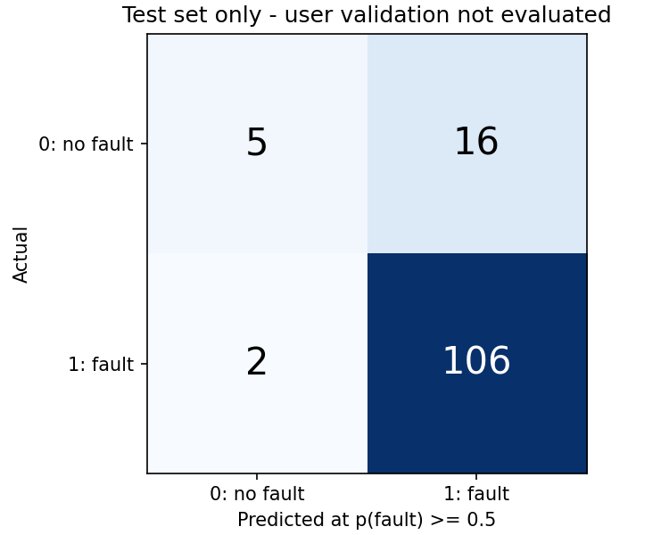

# 电气设备故障判别模型

使用发放的 inspection_tickets.csv，训练 fault_confirmed（二分类：1 为真实故障，0 为空跑），支持模型保存、新 CSV 批量预测和独立验收。项目由 uv 管理，原始任务见 [docs/TASK.md](docs/TASK.md)。

**当前交付按用户指定口径：只使用有标签的数据，分为训练集、测试集、验证集；最后的验证集交给用户验收。**

## 1. 我的判断

原始 961 行中有 46 行完全重复记录。按唯一工单去重后 915 张，其中 46 张未回传标签，不作为有效建模数据。最终有效数据 **869 张：770 张真实故障、99 张空跑**。空标签没有填为 0，原始文件保持不变。

两列时间分别带 +08:00 和 Z，统一为 UTC 后计算遥测滞后分钟数。早期描述性检查发现：遥测 ≤20 分钟时，已回传工单空跑率为 **21/659 = 3.19%**；>20 分钟时为 **78/210 = 37.14%**。应优先检查派单对过期遥测的处理，并将数据新鲜度纳入判别。该组仍有 132 张真实故障，不能按滞后时间直接取消工单；这些数据也不能证明滞后是空跑的因果原因。

## 2. 数据集与训练流程

| 集合 | 文件 | 北京时间范围 | 有效样本 | 用途 |
| --- | --- | --- | ---: | --- |
| 训练集 | [train.csv](datasets/train.csv) | 09-01～09-04 | 498 | 拟合、训练内部选型和选阈值 |
| 测试集 | [test.csv](datasets/test.csv) | 09-05 | 129 | 训练完成后的模型评估 |
| 验证集 | [validation.csv](datasets/validation.csv) | 09-06～09-07 | 242 | **用户自行验收，当前流程不评分** |

三个文件仅包含有 fault_confirmed 值的记录，工单编号互不重叠，合计 869 张；时间与行数见 [manifest.json](datasets/manifest.json)。先去重再划分，零健康分、零额定功率保留；冲突编号、非法数值或时间直接报错。

**实验历史说明：初版曾查看末两天的评估结果，因此不能把当前验证集称为从未查看过的盲测集。当前训练流程已隔离该集，不使用它拟合、选型、调参或输出验收结果。** 数据没有设备 ID，无法排除同一设备跨集合出现。

### 做了什么

- 共享特征逻辑：遥测滞后分钟数、健康分、额定功率、片区、设备类别；标签、工单编号、绝对日期不进入模型特征。
- 训练集内部做 3 折扩展时间交叉验证，各折只用更早样本拟合标准化、类别编码和分类器。没有在测试集或最终验证集上选择模型。
- 对比先验基线、逻辑回归、浅层随机森林、直方图梯度提升；参数固定、随机种子 42。按训练内部平均 Brier score 最低选中 **随机森林**（0.08497；基线 0.10705）。完整比较见 [model_comparison.csv](outputs/model_comparison.csv)、[training_cv.csv](outputs/training_cv.csv)。
- 用所选模型在全部 498 张训练样本上拟合，保存完整预处理与模型到 [fault_model.joblib](artifacts/fault_model.joblib)，版本与选择来源见 [元数据](artifacts/model_metadata.json)。
- 用训练内部 372 条折外预测选择复核阈值；没有用测试结果重新调参。预测入口不需要标签，即使输入包含标签也忽略。

## 3. 测试集验证结果

以下仅来自 **129 张测试工单：108 张真故障、21 张空跑**。分类规则为 p(真实故障) ≥ 0.5 判为 1。

| 指标 | 训练先验基线（分类全部判故障） | 随机森林 |
| --- | ---: | ---: |
| 准确率 | 83.72% | 86.05% |
| 真故障召回率 | 100% | 98.15%（106/108） |
| 空跑识别率 | 0% | 23.81%（5/21） |
| ROC-AUC | 0.5000 | 0.8774 |
| 空跑类别 Average Precision | 0.1628 | 0.5701 |
| Brier score，越低越好 | 0.13882 | 0.09654 |

| 真实情况 / 预测结果 | 预测无故障 | 预测有故障 |
| --- | ---: | ---: |
| 实际空跑 | 5 | 16 |
| 实际真故障 | **2** | 106 |

**模型仍把 2 张真故障预测为无故障，不能保证未来判断正确，也不能自动撤单。** 真故障召回率的 95% Wilson 区间约 93.50%～99.49%，还依赖样本独立等假设。完整指标见 [metrics.json](outputs/metrics.json)，逐条结果见 [test_predictions.csv](outputs/test_predictions.csv)。

## 4. 怎么证明对业务有用

分类阈值为 0.5；另用 p(故障) < **0.60** 标记“建议远程复核”，否则保留正常派单。两个阈值目的不同，复核对象可以包含预测为 1 的低置信度工单，任何预测都不直接取消工单。

复核阈值在训练集折外预测上从 0.00～0.95、步长 0.05 中选取：以“至少 95% 的真故障留在原派单通道”为实验约束，最大化复核完全成功时的净工时，同分优先少复核。95% 是本次提出的分析假设，不是业务认可的 SLA。候选见 [training_thresholds.csv](outputs/training_thresholds.csv)。

| 测试期策略 | 复核数 | 其中空跑 | 其中真故障 | 理想复核下净工时 |
| --- | ---: | ---: | ---: | ---: |
| 不复核 | 0 | 0 | 0 | 0 |
| 全量复核 | 129 | 21 | 108 | 972 |
| 遥测 >20 分钟即复核 | 37 | 17 | 20 | 1,596 |
| 模型概率 <0.60 时复核 | 16 | 9 | 7 | 888 |

模型方案复核 12.40% 的测试工单，覆盖 42.86%（9/21）的已知空跑；但有 **7 张真故障进入复核**，原派单通道保留率 93.52%，**低于训练内部设定的 95% 目标，复核策略没有通过这一测试约束**。因此当前仅交付辅助判断工具，不能称为已具备上线拦截能力。其他策略收益更高但会复核更多真故障，详见 [policy_comparison.csv](outputs/policy_comparison.csv)。

若复核能正确阻止空跑的比例为 q，沿用题设每次空跑 120 工时、复核 12 工时：

~~~text
潜在净工时 = 120 × 9 × q − 12 × 16 = 1080q − 192
q = 100%：888 工时；q = 50%：348 工时；q = 0%：−192 工时
盈亏平衡 q ≈ 17.78%
~~~

这些是情景估算，不是实际收益。真故障复核同样计费，但数据没有复核成功率、误清除、故障延误损失或实际工时，不能假定这些损失不存在。12 工时是工作量，不是允许延误 12 小时。[cost_sensitivity.csv](outputs/cost_sensitivity.csv) 给出成功率敏感性分析。当前结论仅针对已回传样本，未回传偏差仍可能影响泛化。

## 5. 运行与复现

安装 [uv](https://docs.astral.sh/uv/getting-started/installation/)，在仓库根目录运行，Python 3.10 和依赖版本由配置与锁文件确定：

~~~powershell
uv sync --locked
uv run --locked python -m scripts.train
uv run --locked python -m unittest discover -s tests -v
uv run --locked python -m scripts.predict --input outputs/predict_input_example.csv --output outputs/example_predictions.csv
~~~

训练命令会生成三个数据集、模型和测试评估，不会运行最终验证集。示例输入来自测试集前 5 条记录并去掉标签，未补造业务数据。后续预测将 --input 换成新 CSV，只需除标签外的七个原始字段。输出 fault_probability、predicted_fault_confirmed、recommendation、recommendation_reason。

### 由用户执行的最终验收

保持模型不变，用户准备好后自行运行：

~~~powershell
uv run --locked python -m scripts.evaluate --input datasets/validation.csv --output-dir outputs/user_acceptance
~~~

该命令只加载现有模型并输出验收指标及逐单结果，不训练或调整模型。本次没有执行此验收命令，尚无用户验收结论；请结合真故障漏判、空跑识别、工作量与业务风险决定是否接受。

## 6. 交付、验证与限制

- [scripts/common.py](scripts/common.py)：输入校验、共享特征、分类和工时指标。
- [scripts/train.py](scripts/train.py)、[predict.py](scripts/predict.py)、[evaluate.py](scripts/evaluate.py)：训练、无标签预测、用户独立验收。
- [tests/test_pipeline.py](tests/test_pipeline.py)：15 项测试，覆盖时区、去重、缺失标签排除、阈值边界、无标签预测、未知类别与模型序列化；合成样例只用于测试。
- [AI_LOG.md](AI_LOG.md)：真实提示、AI 修正、实验历史和用户调整数据集角色的记录。
- [artifacts/](artifacts/)、[datasets/](datasets/)、[outputs/](outputs/)：可复现模型、分割数据、训练内部与测试期证据。

原始 UTF-8 CSV SHA-256：

~~~text
061e2fb676914b7ded0e3da17b0ffa058a289ea66b5ed6ab292fdc71b49a7ed5
~~~

只加载可信的自训练 joblib 文件。坏输入或预测失败时应检查非零退出码，不能把旧文件当成新结果。当前模型没有独立概率校准保证。

只有一周和 99 个已知空跑样本，且没有设备 ID、故障等级、复核反馈和实际损失，不能外推到新企业或月份。建议先影子运行，保留原派单，补齐回传与设备身份，记录复核效果和故障处置时间；验收后再确定风险容忍度及响应时限。当前没有接入线上告警、执行撤单或声称已节省工时。
